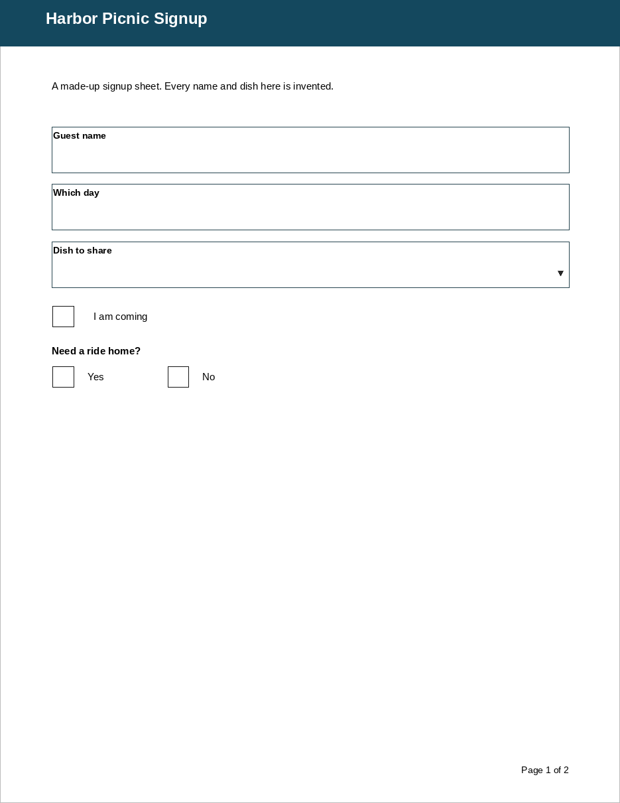
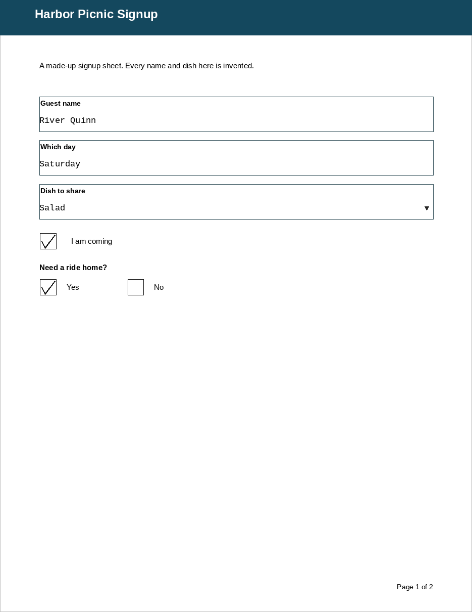
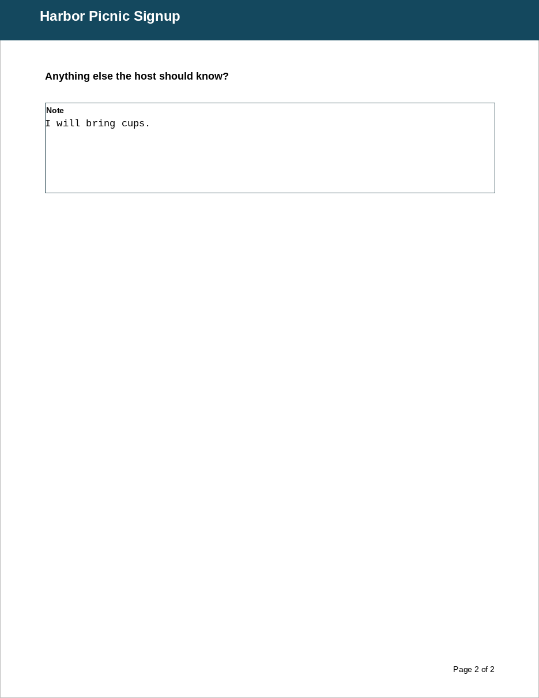

# Oxbow

Oxbow is a Linux PDF reader. It shows ordinary PDF pages, and it opens and fills dynamic XFA forms. Those are the forms Okular and other Linux viewers cannot open: the page stream is empty, so the viewer shows a blank page or a “please wait” notice instead of the form.

## Why it exists

A dynamic XFA form keeps its layout in a template packet and its answers in a datasets packet. Oxbow reads that template and draws it from the published layout rules, then writes answers back into the datasets packet.

## Install

Oxbow needs Python 3, pikepdf, lxml, and Pillow. Ordinary (non-XFA) PDFs also need Poppler’s `pdftoppm`, from the `poppler-utils` package on most distributions.

On Debian, Ubuntu, and similar systems:

```bash
sudo apt install python3 python3-pikepdf python3-lxml python3-pil poppler-utils
git clone https://github.com/markotagolgol-source/oxbow.git
cd oxbow
./run.sh
```

Or install the Python libraries with pip:

```bash
python3 -m pip install -r requirements.txt
./run.sh examples/harbor-picnic.pdf
```

`./run.sh` with no argument opens an empty window. Pass a PDF path to open that file.

### Desktop launcher

```bash
./install-desktop.sh
```

This adds Oxbow to your own application menu under the name Oxbow, using the logo in `assets/logo.png`. It does not need administrator rights. It does not make Oxbow the default program for PDF files. After it runs, Oxbow is in the application grid, can be pinned to the dock, and appears in the file manager’s Open With list for PDF files.

## Fill and save

Open a form, click a box, and type. Enter or Tab commits the field and moves to the next one. Click a checkbox to toggle it. Click one option in an exclusive group to select it and clear the others. A choice list opens as a drop-down.

Save writes the answers into the form’s XFA datasets. The original file is not modified; use Save as to pick the new file. The PDF page streams are left as they were.

A usage-rights signature that covered the original bytes does not cover the saved copy, because the bytes changed. Oxbow does not create signatures.

## Samples

`examples/harbor-picnic.pdf` is a two-page dynamic XFA form made for this repository. The names and answers in the pictures are invented.





The second page is a note.



`examples/club-note.pdf` is an ordinary one-page PDF with a single text field. Oxbow shows that kind of file through Poppler and overlays the field.

Rebuild the samples and the pictures:

```bash
python3 examples/build_samples.py
python3 -m unittest tests.test_samples
```

## Clean room

Oxbow is built from published file-format documentation. It contains no Adobe code, artwork, or name.

## Limitations

- The template’s own Save, Reset, Print, and Validate controls are drawn but not wired. The same is true of + and − row controls. Extra rows are not implemented. Use Oxbow’s own Save.
- Text is drawn with one font per line. A line that mixes a different size, a color, or an underline is still one run. The words are on the page.
- Saved files have not been verified by opening them in Adobe Reader. A rewritten save changes the bytes, so a usage-rights signature no longer covers the file. Oxbow does not claim otherwise.
- Printing builds a PDF and can hand that file to the system print command. That hand-off has not been exercised on a real printer.
- A page with a non-zero `/Rotate` value is shown, and the field overlay on that page is skipped.
